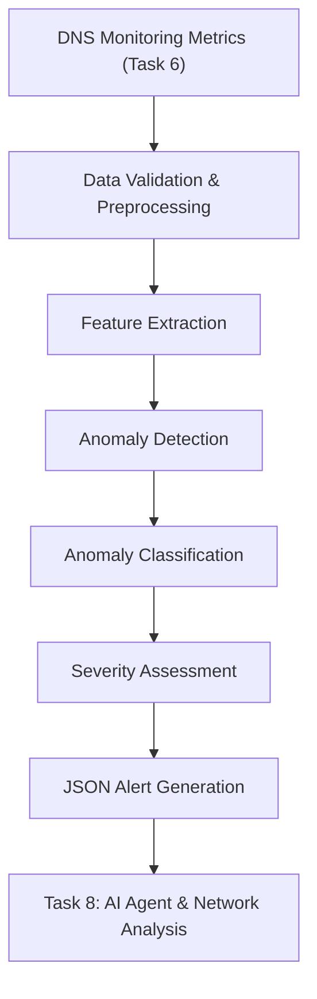

# DNS Anomaly Detection — Task 7

**Project:** Secure and Resilient DNS: From Classical DNS to DNSSEC and DoT/DoH in a Laboratory Environment

**Module:** Task 7 — Machine Learning-Based DNS Anomaly Detection

---

## 1. Project Overview

Task 7 is responsible for detecting abnormal DNS traffic and identifying potentially malicious or abnormal behavior within the DNS infrastructure.

It receives DNS monitoring metrics, analyzes traffic patterns, detects anomalies, classifies their potential causes, and generates structured alerts for further investigation by Task 8.

The objective is to provide an independent and replaceable anomaly detection component that can integrate with the project's global monitoring and analysis architecture.

### Main objectives

- Analyze DNS traffic and infrastructure metrics.
- Establish normal DNS traffic behavior.
- Detect unusual patterns using machine learning.
- Identify potential DNS attacks and operational failures.
- Assign anomaly scores and severity levels.
- Generate structured JSON alerts.
- Provide a standardized interface for integration with other modules.

### Supported anomaly scenarios

The prototype currently simulates the following scenarios:

| Scenario | Description |
|---|---|
| DNS Flood | Abnormally high DNS query volume. |
| DNS Tunneling | Suspicious DNS communication patterns. |
| Authoritative Server Down | Unavailability of an authoritative DNS server. |
| DNSSEC Failure | Increased DNSSEC validation failures. |
| High Latency | Unusually high DNS response times. |
| Resource Overload | Excessive CPU and memory utilization. |
| Traffic Spike | Sudden increase in DNS traffic volume. |

---

## 2. System Architecture

The detection module follows a modular processing pipeline:



### Processing stages

1. **Data Input:** Receives DNS monitoring metrics from Task 6 or simulated datasets.
2. **Preprocessing:** Validates input data, handles missing values and prepares features.
3. **Feature Extraction:** Selects numerical and categorical variables used by the detection model.
4. **Anomaly Detection:** Identifies observations that significantly deviate from normal traffic behavior.
5. **Classification:** Estimates the type of anomaly based on observed metrics.
6. **Severity Assessment:** Assigns a severity level according to anomaly characteristics.
7. **Alert Generation:** Produces structured JSON alerts for Task 8.

The detection engine is designed to remain independent of the downstream AI agent. Task 8 receives the alerts and performs further analysis and decision support.

---

## 3. Dataset Description

### 3.1 Synthetic Dataset

Since real monitoring metrics from Task 6 are not yet available, an initial synthetic dataset was generated to develop and test the detection pipeline.

The dataset contains **1,027 observations**:

| Category | Number of observations |
|---|---:|
| Normal traffic | 900 |
| Anomalous traffic | 127 |
| Total | 1,027 |

The dataset includes normal observations across three DNS transport protocols:

- Classic DNS
- DNS over TLS (DoT)
- DNS over HTTPS (DoH)

It also includes different DNSSEC configurations.

### 3.2 Dataset Features

| Feature | Type | Description |
|---|---|---|
| timestamp | DateTime | Observation timestamp. |
| transport | Categorical | DNS transport protocol. |
| dnssec | Binary | DNSSEC enabled or disabled. |
| query_rate | Numerical | DNS queries per second. |
| avg_latency | Numerical | Average DNS response latency. |
| error_rate | Numerical | Percentage of DNS errors. |
| servfail_rate | Numerical | Percentage of SERVFAIL responses. |
| nxdomain_rate | Numerical | Percentage of NXDOMAIN responses. |
| avg_response_size | Numerical | Average DNS response size. |
| unique_domain_ratio | Numerical | Ratio of unique queried domains. |
| cpu_usage | Numerical | CPU utilization percentage. |
| memory_usage | Numerical | Memory utilization percentage. |
| label | Binary | Ground-truth label: normal (0) or anomaly (1). |
| scenario | Categorical | Simulated traffic scenario. |

**Note:** The current dataset is synthetic. Its values are illustrative and do not represent measurements from a production DNS infrastructure.

### 3.3 Data Generation

The dataset is generated using:

```bash
python src/generate_data.py
```

The generated dataset is saved to:

```text
data/simulated_dns_data.csv
```

---

## 4. Anomaly Detection Methodology

### 4.1 Initial Algorithm: Isolation Forest

The initial implementation uses **Isolation Forest**, an unsupervised machine learning algorithm designed to identify anomalies without requiring labeled attack examples during training.

The model learns patterns from normal DNS traffic and identifies observations that differ significantly from the learned behavior.

Isolation Forest was selected because:

- It does not require attack labels during training.
- It is suitable for detecting unusual combinations of metrics.
- It can handle multiple numerical and categorical features through preprocessing.
- It provides anomaly scores that can be used for threshold-based detection.

### 4.2 Data Preprocessing

The preprocessing pipeline includes:

- Numerical feature imputation using `SimpleImputer`.
- Categorical feature encoding using `OneHotEncoder`.
- Feature transformation using `ColumnTransformer`.

The model uses the following features:

**Categorical features:**
- transport

**Numerical features:**
- dnssec
- query_rate
- avg_latency
- error_rate
- servfail_rate
- nxdomain_rate
- avg_response_size
- unique_domain_ratio
- cpu_usage
- memory_usage

### 4.3 Model Training

The model is trained using normal observations only.

The current training implementation uses a training split of the normal dataset and reserves normal observations for threshold calibration.

The model configuration includes:

| Parameter | Value |
|---|---|
| Algorithm | Isolation Forest |
| Number of estimators | 150 |
| Contamination | auto |
| Random state | 42 |
| Parallel processing | Enabled |

The anomaly threshold is calibrated using the 95th percentile of anomaly scores from normal calibration observations, targeting an initial false-positive rate of approximately 5%.

An observation is classified as anomalous when its anomaly score reaches or exceeds the calibrated threshold.

**Important:** The resulting anomaly score is a relative detection score, not a calibrated probability that an attack is occurring.

### 4.4 Further Investigation: Hybrid Detection

Initial experiments revealed that Isolation Forest does not consistently detect all simulated anomaly scenarios.

In particular, certain DNS-specific patterns can be difficult to distinguish using the learned model alone.

The following approach is therefore being investigated:

- Isolation Forest for general anomaly detection.
- Rule-based detection for known DNS-specific patterns.
- Combined detection results for improved anomaly coverage.

The proposed hybrid architecture aims to retain the flexibility of machine learning while introducing domain-specific detection capabilities.

This approach is currently under investigation and its final performance has not yet been established.

### 4.5 Model Comparison (Phase 3)

Isolation Forest, One-Class SVM and Local Outlier Factor (`novelty=True`) are compared on the same features and splits. Shared logic is in `src/common.py`.

- Normal rows are split 70% training, 15% calibration, 15% testing, stratified by transport and DNSSEC.
- Models are fitted on normal rows only; the threshold is the 95th percentile of calibration scores.
- SVM and LOF use standard-scaled numeric features.
- Results are averaged over 30 splits.

**Note:** `train_model.py` and `detect.py` still use the original Isolation Forest pipeline (70/30 split). No new model has been adopted yet.

---

## 5. Project Structure

```text
dns-anomaly-detection/
│
├── data/
│   ├── simulated_dns_data.csv
│   ├── train_data.csv
│   ├── calibration_data.csv
│   ├── test_data.csv
│   ├── dev_attacks.csv
│   ├── final_test_data.csv
│   └── real_dns_data.csv
│
├── models/
│   ├── isolation_forest.joblib
│   ├── isolation_forest/
│   ├── one_class_svm/
│   ├── lof/
│   └── final/
│
├── results/
│   ├── detections.csv
│   ├── alerts.json
│   ├── evaluation.csv
│   ├── test_data.csv
│   ├── graphs/
│   ├── phase3/
│   ├── phase4/
│   ├── phase5/
│   └── final/
│
├── src/
│   ├── generate_data.py
│   ├── generate_phase3_data.py
│   ├── common.py
│   ├── prepare_data.py
│   ├── train_isolation_forest.py
│   ├── train_one_class_svm.py
│   ├── train_lof.py
│   ├── compare_models.py
│   ├── investigate_parameters.py
│   ├── plot_phase3.py
│   ├── feature_experiments.py
│   ├── tune_models.py
│   ├── final_evaluation.py
│   ├── train_model.py
│   ├── detect.py
│   ├── evaluate_model.py
│   ├── visualize.py
│   ├── validate_data.py
│   └── inspect_errors.py
│
├── requirements.txt
└── README.md
```

### Script descriptions

| Script | Responsibility |
|---|---|
| generate_data.py | Generates synthetic DNS observations. |
| train_model.py | Preprocesses data, trains Isolation Forest and calibrates its threshold. |
| detect.py | Performs anomaly detection and generates alerts. |
| evaluate_model.py | Evaluates detection performance using labeled observations. |
| visualize.py | Generates graphs and visual representations of results. |
| validate_data.py | Checks dataset structure, feature types and data validity. |
| inspect_errors.py | Investigates missed detections and false positives. |
| common.py | Shared features, splits, preprocessing and threshold calibration. |
| prepare_data.py | Saves the training, calibration and test files. |
| train_isolation_forest.py, train_one_class_svm.py, train_lof.py | Train and save one candidate model each. |
| compare_models.py | Compares the three models and writes metrics and graphs. |
| generate_phase3_data.py | Generates milder development attacks and a reserved final test set. |
| investigate_parameters.py | Runs the parameter, scaling, threshold and per-mode checks. |
| plot_phase3.py | Plots the threshold trade-off. |
| feature_experiments.py | Phase 4 feature experiments and distribution plots. |
| tune_models.py | Phase 5 hyperparameter search and confirmation. |
| final_evaluation.py | Phase 6 evaluation on the reserved final test set; saves the chosen model. |

---

## 6. Installation and Setup

### Requirements

- Python 3.10 or later.
- pip.
- Git.
- A Python-compatible development environment.

### 6.1 Clone the repository

```bash
git clone <repository-url>
cd dns-anomaly-detection
```

### 6.2 Create a virtual environment

**Windows:**

```bash
python -m venv venv
venv\Scripts\activate
```

**Linux:**

```bash
python3 -m venv venv
source venv/bin/activate
```

### 6.3 Install dependencies

```bash
pip install -r requirements.txt
```

---

## 7. Execution Guide

Execute the following commands from the project root directory.

### Step 1 — Generate synthetic data

```bash
python src/generate_data.py
```

### Step 2 — Validate the dataset

```bash
python src/validate_data.py
```

### Step 3 — Train the model

```bash
python src/train_model.py
```

The trained model and calibration information are saved in:

```text
models/isolation_forest.joblib
```

### Step 4 — Perform anomaly detection

```bash
python src/detect.py
```

The detection results are saved in:

```text
results/detections.csv
results/alerts.json
```

### Step 5 — Evaluate performance

```bash
python src/evaluate_model.py
```

### Step 6 — Visualize results

```bash
python src/visualize.py
```

### Step 7 — Inspect detection errors

```bash
python src/inspect_errors.py
```

### Model comparison experiments (Phase 3)

```bash
python src/prepare_data.py
python src/train_isolation_forest.py
python src/train_one_class_svm.py
python src/train_lof.py
python src/compare_models.py
python src/generate_phase3_data.py
python src/investigate_parameters.py
python src/plot_phase3.py
python src/feature_experiments.py
python src/tune_models.py
python src/final_evaluation.py
```

---

## 8. Experimental Results

### 8.1 Initial Evaluation

The initial implementation was evaluated using the generated synthetic dataset.

An initial experiment trained the model on normal observations and evaluated it on the same observations. This revealed a high false-positive rate and motivated a more appropriate threshold calibration strategy.

A subsequent experiment used held-out normal observations for threshold calibration and evaluated the model on a dataset containing normal and anomalous observations.

**Preliminary evaluation results:**

| Metric | Normal class | Anomaly class |
|---|---:|---:|
| Precision | 0.91 | 0.88 |
| Recall | 0.95 | 0.80 |
| F1-score | 0.93 | 0.83 |

Overall accuracy: **89.92%**

Confusion matrix:

| | Predicted Normal | Predicted Anomaly |
|---|---:|---:|
| Actual Normal | 256 | 14 |
| Actual Anomaly | 26 | 101 |

### 8.2 Scenario-Level Detection

| Scenario | Detected | Total | Recall |
|---|---:|---:|---:|
| Authoritative Down | 23 | 23 | 100% |
| DNS Flood | 25 | 25 | 100% |
| DNS Tunneling | 21 | 21 | 100% |
| DNSSEC Failure | 5 | 15 | 33.3% |
| High Latency | 4 | 13 | 30.8% |
| Resource Overload | 20 | 20 | 100% |
| Traffic Spike | 3 | 10 | 30.0% |

### 8.3 Error Analysis

The analysis of missed detections revealed three particularly interesting patterns:

**DNSSEC failures**
- Significantly increased SERVFAIL rates.
- Increased error rates.
- Relatively normal query rates and resource utilization.

**High-latency events**
- Very high response latency over DoH.
- Relatively normal error and SERVFAIL rates.
- No significant increase in CPU or memory usage.

**Traffic spikes**
- Query rates significantly above normal DoH baselines.
- Other infrastructure metrics remained relatively normal.

These findings motivated the investigation of a hybrid detection strategy.

### 8.4 Evaluation Limitations

The reported results are preliminary.

The normal observations used to evaluate the calibrated threshold were also used during threshold calibration. Therefore, the measured false-positive rate is not an independent estimate of generalization performance.

Further evaluation will use separate training, calibration and final testing datasets.

The synthetic dataset is also relatively small and does not reproduce every characteristic of real DNS traffic.

The results should therefore not be interpreted as production-level detection performance.

### 8.5 Phase 3: Parameter Investigation

Development results on 780 synthetic mild and moderate attacks, mean of 30 splits, 95th percentile threshold. Recall is the average over the seven scenarios.

| Model | Selected settings | Recall | False-positive rate | High latency | Traffic spike |
|---|---|---:|---:|---:|---:|
| Isolation Forest | n_estimators=300, max_samples=1.0, max_features=0.5, bootstrap=False | 83.3% | 5.5% | 51% | 40% |
| One-Class SVM | rbf, nu=0.1, gamma=0.3 | 97.7% | 4.8% | 89% | 95% |
| LOF | n_neighbors=5, metric=euclidean | 98.0% | 4.8% | 92% | 95% |

These were intermediate settings; Phase 5 replaced them.

Interpretation:

- A simple rule (any numeric value outside the training range) reaches 96.2% recall with 1.9% false positives. LOF at the 99th percentile is similar (96.4%, 1.4%). This data does not show a clear benefit of ML over simple limits.
- Attack rows were used to choose the settings, so these are not final results.
- Severity levels are assumptions, and `error_rate` is assumed to include SERVFAIL in the new data.
- `data/final_test_data.csv` was kept unscored until Phase 6.

### 8.6 Phase 4: Features

Adding `query_rate` and `avg_latency` relative to the normal training median of the same transport and DNSSEC mode improved detection of high latency and traffic spikes. Log transforms made results worse.

### 8.7 Phase 5: Tuning

Development data, mean of 30 splits, 95th percentile threshold. All use the original features plus the two relative features.

| Model | Selected settings | Recall | False-positive rate |
|---|---|---:|---:|
| LOF | n_neighbors=35, metric=manhattan | 99.5% | 5.8% |
| One-Class SVM | rbf, nu=0.01, gamma=0.3 | 99.4% | 5.9% |
| Isolation Forest | n_estimators=300, max_samples=1.0, max_features=0.5 | 89.9% | 6.0% |

LOF and One-Class SVM are effectively tied. LOF with the 97.5th percentile threshold was fixed before the final evaluation.

### 8.8 Phase 6: Final Test

600 new normal rows and 624 new mild and moderate synthetic attacks. All models use the 97.5th percentile threshold.

| Detector | Precision | Recall | F1 | False-positive rate |
|---|---:|---:|---:|---:|
| LOF (chosen) | 98.1% | 98.9% | 0.985 | 2.0% |
| One-Class SVM | 97.0% | 98.9% | 0.979 | 3.2% |
| Isolation Forest | 97.5% | 87.0% | 0.920 | 2.3% |
| Range rule (relative features) | 97.9% | 98.2% | 0.981 | 2.2% |

LOF missed 7 of 624 attacks (5 high latency, 1 tunneling, 1 traffic spike, all mild) and raised 12 false alarms on 600 normal rows.

Limitations:

- The range rule performs almost as well as LOF, so this data does not demonstrate a clear benefit of ML.
- The final test comes from the same kind of generator as the development data. It does not show real-world performance.
- Strong-severity attacks are not part of the final test.
- The chosen model is saved in `models/final/model.joblib` and is not yet used by `detect.py`.

---

## 9. Alert Generation and Task 8 Integration

Task 7 generates structured JSON alerts that can be consumed by the AI agent developed in Task 8.

Each alert contains information about the detected anomaly, its severity, the detection score and the affected target.

### 9.1 Alert Structure

The output follows the JSON schema provided by Task 8.

Example:

```json
{
  "alert_id": "DNS-ALERT-001",
  "timestamp": "2026-11-24T14:30:00Z",
  "anomaly_type": "flood",
  "severity": "high",
  "score": 0.94,
  "source_ip": "unknown",
  "target": "resolver (10.10.10.20)",
  "transport": "classic",
  "features": {
    "qps": 774.26,
    "nxdomain_rate": 5.2
  }
}
```

### 9.2 Supported Alert Types

The current Task 8 schema supports:

- flood
- tunneling
- nxdomain_burst
- amplification
- unknown

Some internal detection scenarios, such as DNSSEC failures and high latency, must be mapped to the closest supported alert category or `unknown` until the shared schema is extended.

### 9.3 Integration Requirements

- Generated alerts must comply with the Task 8 JSON schema.
- Required fields must be present.
- Timestamps must follow ISO 8601 format.
- Severity must use the agreed enumeration.
- Anomaly scores must be between 0 and 1.
- Missing source IP information must not be fabricated.

The current synthetic dataset does not provide a real source IP for every observation, so the prototype uses `"unknown"` when that information is unavailable.

Schema validation and end-to-end integration testing remain part of the integration work.

---

## 10. Task 6 Integration

Task 6 is responsible for collecting and preparing DNS monitoring metrics.

Task 7 is designed to consume these metrics without depending on the implementation details of the monitoring infrastructure.

### Expected input features

The proposed input contract includes:

- timestamp
- transport
- dnssec
- query_rate
- avg_latency
- error_rate
- servfail_rate
- nxdomain_rate
- avg_response_size
- unique_domain_ratio
- cpu_usage
- memory_usage

The final mapping will be adapted to the actual output format provided by Task 6.

### Integration objectives

1. Receive monitoring data from Task 6.
2. Validate the input structure.
3. Map incoming metrics to the model's expected features.
4. Perform anomaly detection.
5. Generate alerts for Task 8.

**Note:** The input contract is provisional and must be confirmed against Task 6's actual data output.

---

## 11. Limitations and Future Work

### Current limitations

- The model is currently evaluated using synthetic data.
- The dataset does not cover every possible DNS attack.
- Some attack scenarios are not consistently detected.
- Real source IP information is not yet integrated.
- The detection threshold in the current detection pipeline requires independent validation.
- The current alert mapping does not represent every internal anomaly category.

### Future improvements

- Implement and evaluate the hybrid ML and rule-based detection approach.
- Improve detection of DNSSEC failures, high latency and traffic spikes.
- Test with real DNS monitoring data from Task 6.
- Investigate external DNS datasets for additional benchmarking.
- Validate generated alerts against the Task 8 JSON schema.
- Perform end-to-end testing with the AI agent.
- Evaluate detection performance on unseen traffic.
- Investigate temporal anomaly detection and traffic behavior over time.

---

## 12. Technologies Used

| Technology | Purpose |
|---|---|
| Python | Main implementation language. |
| Pandas | Dataset manipulation and analysis. |
| NumPy | Numerical operations. |
| Scikit-learn | Preprocessing and Isolation Forest. |
| Joblib | Model persistence. |
| Matplotlib | Data visualization. |
| Seaborn | Statistical visualizations, if used. |
| JSON | Alert exchange format. |
| Git | Version control. |

---

## 13. Conclusion

Task 7 provides the machine learning-based anomaly detection component of the secure DNS laboratory project.

The initial implementation establishes a baseline using Isolation Forest, evaluates its behavior across multiple simulated DNS scenarios, and investigates the causes of detection errors.

The next development phase focuses on improving detection coverage through hybrid anomaly detection, integrating real monitoring metrics from Task 6, and ensuring compatibility with the alert-processing architecture of Task 8.

The overall objective is to deliver a modular, extensible and measurable DNS anomaly detection component that contributes to the monitoring and resilience of the laboratory DNS infrastructure.

---

 