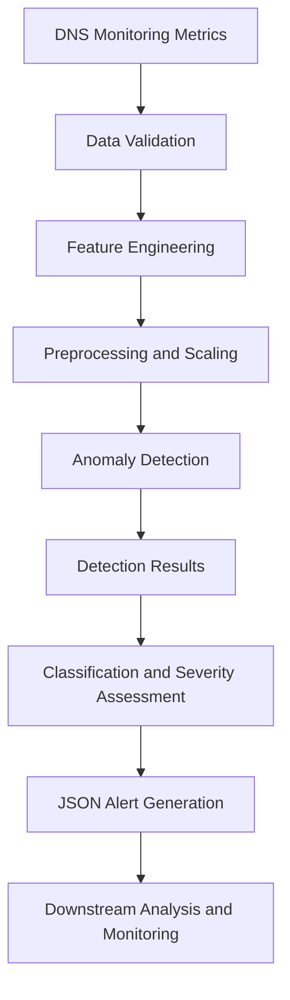

# DNS Anomaly Detection — Task 7

**Project:** Secure and Resilient DNS: From Classical DNS to DNSSEC and DoT/DoH in a Laboratory Environment  
**Module:** Task 7 — Machine Learning-Based DNS Anomaly Detection

---

## 1. Project Overview

Task 7 is responsible for detecting abnormal DNS traffic and identifying potentially malicious or abnormal behavior within the DNS infrastructure.

It analyzes DNS monitoring metrics, learns normal traffic behavior, detects deviations, and produces structured alerts for further investigation.

The objective is to develop an independent, modular and replaceable anomaly detection component that can integrate with the project's global monitoring and analysis architecture.

### Main objectives

- Analyze DNS traffic and infrastructure metrics.
- Establish normal DNS behavior under different DNS configurations.
- Detect unusual patterns using unsupervised machine learning.
- Identify potential DNS attacks and operational failures.
- Generate anomaly scores and detection results.
- Produce structured JSON alerts.
- Provide a standardized interface for integration with other modules.

### Supported anomaly scenarios

| Scenario | Description |
|---|---|
| DNS Flood | Abnormally high DNS query volume. |
| DNS Tunneling | Suspicious DNS communication patterns. |
| Authoritative Server Down | Unavailability of an authoritative DNS server. |
| DNSSEC Failure | Increased DNSSEC validation failures. |
| High Latency | Unusually high DNS response times. |
| Resource Overload | Excessive CPU and memory utilization. |
| Traffic Spike | Sudden increase in DNS traffic volume. |

---

## 2. System Architecture

The detection module follows a modular processing pipeline:



### Processing stages

1. **Data Input:** Receives DNS monitoring metrics or simulated datasets.
2. **Validation:** Checks input structure, feature types and data validity.
3. **Feature Engineering:** Extracts and derives features that describe DNS behavior.
4. **Preprocessing:** Handles missing values, encodes categorical variables and scales numerical features where required.
5. **Anomaly Detection:** Identifies observations that deviate from learned normal behavior.
6. **Classification:** Associates detected anomalies with potential scenarios using available metrics and detection logic.
7. **Severity Assessment:** Assigns a severity level according to anomaly characteristics.
8. **Alert Generation:** Produces structured JSON alerts for downstream components.

The detection engine is designed to remain independent of the downstream analysis component.

---

## 3. Dataset Description

### 3.1 Synthetic Dataset

Since real monitoring metrics are not yet available for all experiments, synthetic DNS observations are used to develop and evaluate the detection pipeline.

The initial dataset contains **1,027 observations**:

| Category | Number of observations |
|---|---:|
| Normal traffic | 900 |
| Anomalous traffic | 127 |
| Total | 1,027 |

The observations represent three DNS transport protocols:

- Classic DNS
- DNS over TLS (DoT)
- DNS over HTTPS (DoH)

They also cover different DNSSEC configurations.

Additional development datasets were generated for later experiments, including milder and moderate anomaly scenarios.

### 3.2 Dataset Features

| Feature | Type | Description |
|---|---|---|
| timestamp | DateTime | Observation timestamp. |
| transport | Categorical | DNS transport protocol. |
| dnssec | Binary | DNSSEC enabled or disabled. |
| query_rate | Numerical | DNS queries per second. |
| avg_latency | Numerical | Average DNS response latency. |
| error_rate | Numerical | Percentage of DNS errors. |
| servfail_rate | Numerical | Percentage of SERVFAIL responses. |
| nxdomain_rate | Numerical | Percentage of NXDOMAIN responses. |
| avg_response_size | Numerical | Average DNS response size. |
| unique_domain_ratio | Numerical | Ratio of unique queried domains. |
| cpu_usage | Numerical | CPU utilization percentage. |
| memory_usage | Numerical | Memory utilization percentage. |
| label | Binary | Ground-truth label: normal (0) or anomaly (1). |
| scenario | Categorical | Simulated traffic scenario. |

### 3.3 Data Generation

The initial dataset is generated using:

```bash
python src/generate_data.py
```

Output:

```text
data/simulated_dns_data.csv
```

Additional development and evaluation datasets are generated using the corresponding phase-specific data generation scripts.

**Note:** All current experimental datasets are synthetic. Their values are illustrative and do not represent measurements from a production DNS infrastructure.

---

## 4. Anomaly Detection Methodology

The detection pipeline has evolved through several experimental phases.

### 4.1 Initial Algorithm: Isolation Forest

The initial implementation uses **Isolation Forest**, an unsupervised machine learning algorithm designed to identify anomalies without requiring labeled attack examples during training.

The model learns patterns from normal DNS observations and identifies observations that differ significantly from the learned behavior.

Isolation Forest was initially selected because:

- It does not require attack labels during training.
- It can detect unusual combinations of metrics.
- It supports multivariate anomaly detection.
- It produces anomaly scores that can be used for threshold-based detection.

### 4.2 Initial Preprocessing

The initial preprocessing pipeline includes:

- Numerical imputation using `SimpleImputer`.
- Categorical encoding using `OneHotEncoder`.
- Feature transformation using `ColumnTransformer`.

The original model uses:

**Categorical features:**
- transport

**Numerical features:**
- dnssec
- query_rate
- avg_latency
- error_rate
- servfail_rate
- nxdomain_rate
- avg_response_size
- unique_domain_ratio
- cpu_usage
- memory_usage

### 4.3 Training and Threshold Calibration

The unsupervised models are fitted using normal observations only.

Normal observations are separated into:

- Training data.
- Calibration data.
- Held-out normal test data.

Attack observations are reserved for evaluation rather than model fitting.

The anomaly threshold is calibrated using the 95th percentile of anomaly scores from normal calibration observations.

An observation is classified as anomalous when its anomaly score reaches or exceeds the calibrated threshold.

**Important:** An anomaly score represents a relative measure of abnormality, not a calibrated probability that an attack is occurring.

---

## 5. Phase 3 — Model Comparison and Hyperparameter Selection

Phase 3 expanded the initial Isolation Forest implementation into a comparison of three unsupervised anomaly detection algorithms.

### 5.1 Evaluated Models

| Algorithm | Description |
|---|---|
| Isolation Forest | Detects anomalies by isolating observations through randomized decision trees. |
| One-Class SVM | Learns a boundary around normal observations using a kernel-based approach. |
| Local Outlier Factor (LOF) | Identifies observations with substantially different local density from their neighbors. |

LOF is configured with `novelty=True` so it can evaluate previously unseen observations.

### 5.2 Experimental Methodology

The experiments use:

- Normal-only training.
- Separate normal calibration data.
- A held-out test set containing normal and anomalous observations.
- A 95th-percentile calibration threshold.
- Repeated experiments over 30 random splits.
- Shared preprocessing and feature definitions.

Normal observations are divided into:

| Split | Percentage |
|---|---:|
| Training | 70% |
| Calibration | 15% |
| Testing | 15% |

The attack observations are reserved for evaluation.

The models are compared using:

- Precision.
- Recall.
- F1-score.
- False-positive rate (FPR).
- ROC-AUC.
- PR-AUC.
- Scenario-level recall.

### 5.3 Selected Hyperparameters

The parameter investigation selected the following configurations:

| Model | Selected configuration |
|---|---|
| Isolation Forest | `n_estimators=300`, `max_samples=1.0`, `max_features=0.5`, `bootstrap=False` |
| One-Class SVM | `kernel=rbf`, `nu=0.1`, `gamma=0.3` |
| LOF | `n_neighbors=5`, `metric=euclidean` |

These configurations were selected from development experiments under the chosen false-positive-rate constraint.

They are experimental candidates, not universally optimal configurations.

### 5.4 Phase 3 Results

Mean results over 30 development splits using the selected configurations and the 95th-percentile threshold:

| Model | Recall | FPR | PR-AUC | High Latency Recall | Traffic Spike Recall |
|---|---:|---:|---:|---:|---:|
| Isolation Forest | 83.3% | 5.5% | 0.994 | 51.1% | 39.5% |
| One-Class SVM | 97.7% | 4.8% | 0.999 | 88.8% | 94.9% |
| LOF | 98.0% | 4.8% | 0.999 | 91.8% | 94.6% |

The results indicated that LOF and One-Class SVM substantially outperformed the initial Isolation Forest configuration on the development data.

### 5.5 Parameter Investigation Findings

Additional experiments examined:

- Number of estimators and sampling settings for Isolation Forest.
- Kernel, `nu` and `gamma` for One-Class SVM.
- Number of neighbors and distance metrics for LOF.
- Threshold percentile selection.
- Numerical feature scaling.
- Performance across transport and DNSSEC configurations.

Standard scaling improved the performance of both One-Class SVM and LOF.

The experiments also revealed that a simple numerical range-based detector could achieve competitive performance, motivating further investigation into feature engineering and baseline comparisons.

---

## 6. Phase 4 — Relative Feature Engineering

Phase 4 focused on improving the representation of DNS behavior by introducing relative query-rate and latency features.

### 6.1 Motivation

Absolute metric values do not necessarily have the same meaning across different DNS configurations.

For example, a query rate or response latency that is normal for one transport configuration may be unusual for another.

The same applies to DNSSEC-enabled and DNSSEC-disabled configurations.

Using one global baseline can therefore make it difficult to distinguish genuine anomalies from normal differences between configurations.

### 6.2 Relative Features

Phase 4 introduced two additional types of information:

- Query rate relative to the normal level for the same transport and DNSSEC configuration.
- Average latency relative to the normal level for the same transport and DNSSEC configuration.

These features provide the detection algorithms with context about how much an observation deviates from the expected behavior of its corresponding DNS configuration.

The reference normal levels must be calculated using normal training observations only, preventing information from calibration or test observations from influencing feature construction.

### 6.3 Logarithmic Transformation Investigation

Logarithmic transformations were also investigated as an alternative feature transformation.

However, the experiments showed that logarithmic transformations reduced performance across the evaluated models.

Consequently, logarithmic transformations were not retained in the Phase 4 configuration.

### 6.4 Feature Correlation Analysis

Correlation analysis within normal transport/DNSSEC groups showed that the numerical features were generally only weakly correlated.

Therefore, the current approach retains the existing numerical features rather than removing features solely based on correlation.

Feature importance can differ between algorithms:

- `error_rate` and `servfail_rate` had relatively little influence on One-Class SVM and LOF.
- These features remained more influential for Isolation Forest.

This suggests that feature relevance depends on the detection algorithm and should be evaluated experimentally.

### 6.5 Phase 4 Results

Development results averaged over 30 splits:

| Model | Phase 3 Recall | Phase 4 Recall | High Latency Recall |
|---|---:|---:|---:|
| LOF | 98.0% | 99.0% | 98% |
| One-Class SVM | 97.8% | 99.4% | 99% |
| Isolation Forest | 83.6% | 90.8% | Improved, but still weaker overall |

For Isolation Forest, relative features were added as additional columns. Although overall recall improved, DNSSEC failure and DNS tunneling detection became worse.

This indicates that feature engineering does not necessarily benefit every algorithm or anomaly scenario equally.

### 6.6 Comparison Against a Simple Range-Based Detector

An important Phase 4 experiment compared the machine learning models against a simple rule-based baseline using the relative features.

The baseline flags observations when numerical features fall outside their corresponding normal training ranges.

| Detector | Recall | False-Positive Rate |
|---|---:|---:|
| Simple range-based rule | 98.9% | 2.9% |
| LOF | Approximately 99.0% | Approximately 5–6% |
| One-Class SVM | Approximately 99.4% | Approximately 5–6% |
| Isolation Forest | Approximately 90.8% | Approximately 5–6% |

The exact model false-positive rates depend on the corresponding experimental configuration.

### 6.7 Interpretation

The relative features improved machine learning detection, particularly for high-latency anomalies.

However, the simple range-based detector achieved comparable recall with a lower false-positive rate.

This is a significant finding: the current synthetic dataset does not demonstrate a clear performance advantage for machine learning over a simpler threshold-based approach.

One possible explanation is that the synthetic data generator creates many attacks by multiplying normal values within their corresponding transport/DNSSEC groups.

Relative features may therefore make these generated attacks particularly easy to distinguish.

Further validation on independently generated and more realistic traffic is required before drawing conclusions about real-world detection performance.

---

## 7. Current Model Assessment

Based on the Phase 4 development experiments:

| Model | Current assessment |
|---|---|
| LOF | Strong candidate with high recall and good mild-anomaly detection. |
| One-Class SVM | Strong candidate with the highest reported overall recall. |
| Isolation Forest | Useful comparison baseline, but weaker on several anomaly scenarios. |
| Range-based detector | Strong simple baseline that currently outperforms ML in false-positive rate. |

No final production model has been selected.

The choice should depend on performance against unseen evaluation data, computational requirements, maintainability and integration constraints.

---

## 8. Project Structure

The project currently follows a structure similar to:

```text
dns-anomaly-detection/
│
├── data/
│   ├── simulated_dns_data.csv
│   ├── train_data.csv
│   ├── calibration_data.csv
│   ├── test_data.csv
│   ├── dev_attacks.csv
│   ├── final_test_data.csv
│   └── real_dns_data.csv
│
├── models/
│   ├── isolation_forest.joblib
│   ├── isolation_forest/
│   ├── one_class_svm/
│   └── lof/
│
├── results/
│   ├── detections.csv
│   ├── alerts.json
│   ├── evaluation.csv
│   ├── graphs/
│   └── phase3/
│
├── src/
│   ├── generate_data.py
│   ├── generate_phase3_data.py
│   ├── common.py
│   ├── prepare_data.py
│   ├── train_isolation_forest.py
│   ├── train_one_class_svm.py
│   ├── train_lof.py
│   ├── compare_models.py
│   ├── investigate_parameters.py
│   ├── plot_phase3.py
│   ├── train_model.py
│   ├── detect.py
│   ├── evaluate_model.py
│   ├── visualize.py
│   ├── validate_data.py
│   └── inspect_errors.py
│
├── requirements.txt
└── README.md
```

The exact contents of the `data/`, `models/` and `results/` directories depend on the experiments executed.

### Main script descriptions

| Script | Responsibility |
|---|---|
| `generate_data.py` | Generates the initial synthetic DNS dataset. |
| `validate_data.py` | Checks dataset structure and data validity. |
| `train_model.py` | Trains the original Isolation Forest implementation. |
| `detect.py` | Runs the original detection pipeline and generates alerts. |
| `evaluate_model.py` | Evaluates the original detection implementation. |
| `visualize.py` | Generates detection visualizations. |
| `inspect_errors.py` | Investigates false positives and missed detections. |
| `common.py` | Shared features, preprocessing, splits and calibration logic. |
| `prepare_data.py` | Prepares training, calibration and test datasets. |
| `train_isolation_forest.py` | Trains and saves the Isolation Forest candidate. |
| `train_one_class_svm.py` | Trains and saves the One-Class SVM candidate. |
| `train_lof.py` | Trains and saves the LOF candidate. |
| `compare_models.py` | Evaluates and compares the candidate models. |
| `generate_phase3_data.py` | Generates additional development and evaluation data. |
| `investigate_parameters.py` | Investigates hyperparameters, thresholds, scaling and relative features. |
| `plot_phase3.py` | Generates experimental plots. |

---

## 9. Installation and Setup

### Requirements

- Python 3.10 or later.
- pip.
- Git.
- A Python-compatible development environment.

### 9.1 Clone the repository

```bash
git clone <repository-url>
cd dns-anomaly-detection
```

### 9.2 Create a virtual environment

**Windows:**

```bash
python -m venv venv
venv\Scripts\activate
```

**Linux:**

```bash
python3 -m venv venv
source venv/bin/activate
```

### 9.3 Install dependencies

```bash
pip install -r requirements.txt
```

---

## 10. Execution Guide

Run commands from the project root directory.

### 10.1 Initial Isolation Forest Pipeline

Generate the initial dataset:

```bash
python src/generate_data.py
```

Validate the dataset:

```bash
python src/validate_data.py
```

Train the original Isolation Forest:

```bash
python src/train_model.py
```

Run anomaly detection:

```bash
python src/detect.py
```

Evaluate:

```bash
python src/evaluate_model.py
```

Generate visualizations:

```bash
python src/visualize.py
```

Inspect errors:

```bash
python src/inspect_errors.py
```

### 10.2 Model Comparison Pipeline

Prepare the datasets:

```bash
python src/prepare_data.py
```

Train the candidate models:

```bash
python src/train_isolation_forest.py
python src/train_one_class_svm.py
python src/train_lof.py
```

Compare their performance:

```bash
python src/compare_models.py
```

### 10.3 Phase 3 and Phase 4 Experiments

Generate the additional development data:

```bash
python src/generate_phase3_data.py
```

Run the parameter and feature investigation:

```bash
python src/investigate_parameters.py
```

Generate the experimental plots:

```bash
python src/plot_phase3.py
```

**Note:** Some scripts may reuse previously generated datasets and saved models. Run the preparation and training steps required by the actual implementation before executing an evaluation or investigation script.

---

## 11. Experimental Results and Evaluation Limitations

### 11.1 Initial Isolation Forest Evaluation

The initial implementation was evaluated using the original synthetic dataset.

Historical results:

| Metric | Normal class | Anomaly class |
|---|---:|---:|
| Precision | 0.91 | 0.88 |
| Recall | 0.95 | 0.80 |
| F1-score | 0.93 | 0.83 |

Overall accuracy: **89.92%**

Confusion matrix:

| | Predicted Normal | Predicted Anomaly |
|---|---:|---:|
| Actual Normal | 256 | 14 |
| Actual Anomaly | 26 | 101 |

These figures belong to the initial implementation and should not be compared directly with the later 30-split experiments, which use a different evaluation methodology.

### 11.2 Scenario-Level Initial Evaluation

| Scenario | Detected | Total | Recall |
|---|---:|---:|---:|
| Authoritative Down | 23 | 23 | 100% |
| DNS Flood | 25 | 25 | 100% |
| DNS Tunneling | 21 | 21 | 100% |
| DNSSEC Failure | 5 | 15 | 33.3% |
| High Latency | 4 | 13 | 30.8% |
| Resource Overload | 20 | 20 | 100% |
| Traffic Spike | 3 | 10 | 30.0% |

### 11.3 Evaluation Limitations

The current results are development experiments, not production performance guarantees.

Important limitations include:

- The data is synthetic.
- Attack examples are generated using predefined patterns.
- The same underlying development dataset is reused across repeated splits.
- The attack examples have influenced parameter selection.
- The 30 repeated splits are not 30 independent datasets.
- The relative features may exploit characteristics introduced by the data generator.
- The simple range-based detector remains a strong baseline.
- The final independent evaluation dataset has not yet been used to establish generalization performance.

A separate final evaluation must be conducted without using its observations to tune parameters, thresholds or feature transformations.

---

## 12. Alert Generation and Downstream Integration

Task 7 is designed to generate structured JSON alerts that can be consumed by the project's downstream analysis component.

### 12.1 Example Alert

```json
{
  "alert_id": "DNS-ALERT-001",
  "timestamp": "2026-11-24T14:30:00Z",
  "anomaly_type": "flood",
  "severity": "high",
  "score": 0.94,
  "source_ip": "unknown",
  "target": "resolver (10.10.10.20)",
  "transport": "classic",
  "features": {
    "qps": 774.26,
    "nxdomain_rate": 5.2
  }
}
```

### 12.2 Supported Alert Types

The current shared alert schema supports:

- flood
- tunneling
- nxdomain_burst
- amplification
- unknown

Internal detection scenarios such as DNSSEC failures and high latency may require additional mappings or schema extensions.

### 12.3 Integration Requirements

- Alerts must comply with the shared JSON schema.
- Required fields must be present.
- Timestamps must follow ISO 8601 format.
- Severity must use the agreed enumeration.
- Anomaly scores must follow the agreed score definition and range.
- Missing source IP information must not be fabricated.

The synthetic dataset does not provide a real source IP for every observation, so the prototype uses `"unknown"` when that information is unavailable.

End-to-end integration and schema validation remain part of the integration work.

---

## 13. Monitoring Data Integration

Task 7 is designed to consume monitoring metrics collected by the DNS monitoring component.

### Expected input features

- timestamp
- transport
- dnssec
- query_rate
- avg_latency
- error_rate
- servfail_rate
- nxdomain_rate
- avg_response_size
- unique_domain_ratio
- cpu_usage
- memory_usage

The final mapping will be adapted to the actual monitoring output.

### Integration objectives

1. Receive monitoring data.
2. Validate the input structure.
3. Map incoming metrics to the model's expected features.
4. Calculate the relative features using training-derived normal reference levels.
5. Perform anomaly detection.
6. Generate alerts for downstream analysis.

**Important:** The normal reference levels used for relative features must be persisted alongside the trained model and reused during inference. They must not be recalculated using incoming test or production observations.

---

## 14. Limitations and Future Work

### Current limitations

- The current evaluation relies on synthetic data.
- The attack generator may produce overly predictable anomaly patterns.
- Generalization to unseen attacks has not yet been established.
- The range-based detector currently outperforms ML models in false-positive rate.
- Some anomaly scenarios remain more difficult to detect than others.
- Real source IP information is not yet integrated.
- Alert classification and severity mapping require further validation.
- End-to-end integration remains incomplete.

### Next development priorities

**1. Independent generalization testing**

Generate a new evaluation dataset with different seeds, overlapping normal and attack distributions, and less predictable attack behavior.

**2. Stronger baseline comparisons**

Compare ML algorithms against simple range-based and domain-specific rule-based detectors.

**3. Feature engineering validation**

Evaluate whether relative features remain useful when attack patterns do not simply multiply normal values.

**4. Unusual feature combinations**

Introduce anomalies that remain within individual normal feature ranges but exhibit unusual combinations of metrics. This can help evaluate whether multivariate ML detection provides an advantage over independent thresholds.

**5. Model selection**

Select a final model based on independent recall, false-positive rate, precision, inference time and scenario-level performance.

**6. Real monitoring data**

Test the detection pipeline using actual DNS monitoring metrics.

**7. Integration**

Validate generated alerts against the shared JSON schema and perform end-to-end integration tests.

**8. Temporal anomaly detection**

Investigate time-dependent traffic behavior and sudden changes that cannot be captured by isolated observations.

---

## 15. Technologies Used

| Technology | Purpose |
|---|---|
| Python | Main implementation language. |
| Pandas | Dataset manipulation and analysis. |
| NumPy | Numerical operations. |
| Scikit-learn | Preprocessing and anomaly detection algorithms. |
| Joblib | Model persistence. |
| Matplotlib | Data visualization. |
| Seaborn | Statistical visualizations, if used. |
| JSON | Alert exchange format. |
| Git | Version control. |

---

## 16. Conclusion

Task 7 has evolved from an initial Isolation Forest prototype into a comparative anomaly detection framework evaluating multiple unsupervised learning algorithms and feature engineering strategies.

Phase 3 established a common experimental methodology for comparing Isolation Forest, One-Class SVM and Local Outlier Factor.

Phase 4 investigated transport- and DNSSEC-aware relative features, improving detection performance, particularly for high-latency anomalies.

However, comparison against a simple range-based detector revealed that machine learning does not yet demonstrate a clear advantage on the current synthetic dataset.

The next stage focuses on independent evaluation using more challenging data, testing generalization to unseen anomaly patterns, and determining whether multivariate machine learning provides measurable value beyond simpler detection rules.

The overall objective is to deliver a modular, extensible and measurable DNS anomaly detection component that contributes to the monitoring and resilience of the laboratory DNS infrastructure.